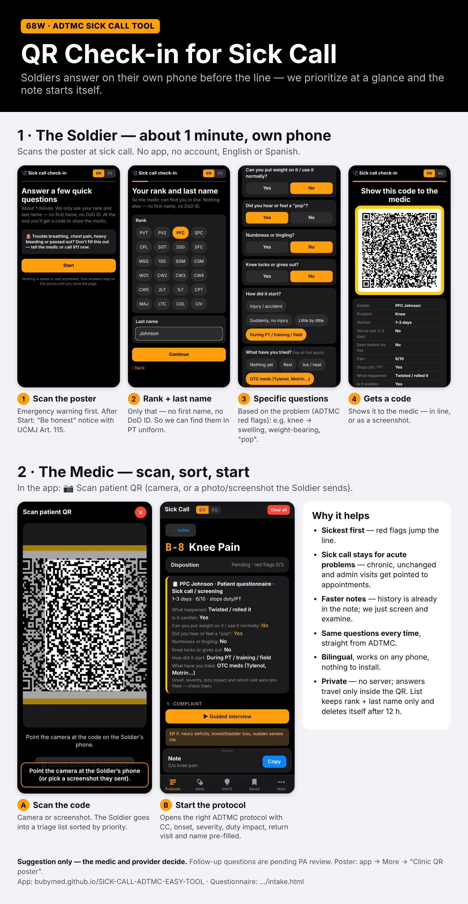

# Sick Call — 68W ADTMC documentation tool

An  offline, single-page tool that helps a combat medic (68W) write a short, clear sick-call note.
Interview with **OPQRST / AMPLE**, screen for **red flags** with the **ADTMC** (Algorithm-Directed Troop Medical Care, MEDCOM Pam 40-7-21, 13 Nov 2019),
and get a suggested plan and disposition. The note is plain English text ready to copy to a slip.

> **For trained medics and medical personnel only — not for self-diagnosis or self-treatment.** Soldiers who feel sick should use the [sick call questionnaire](https://bubymed.github.io/SICK-CALL-ADTMC-EASY-TOOL/intake.html) and see their medic.
>
> **Not medical advice.** This is a documentation aid. It does not replace clinical judgment,
> the official ADTMC, local SOPs or a provider. The ADTMC content was transcribed by hand and may
> contain errors — always verify against your official copy. Check with your chain of command
> before using any tool in an official workflow.

## ▶ New: QR Check-in for Sick Call / Registro con QR

Soldiers scan a poster and answer ~1 minute of ADTMC-based questions on their own phone (rank + last name only).
They get a QR that **helps the medic prioritize the line at a glance**.
The medic scans it and the app opens the right ADTMC protocol with the history already in the note.

Los soldados escanean un póster y contestan ~1 minuto de preguntas del ADTMC en su teléfono (solo rango + apellido).
Les sale un QR que **ayuda al médico a priorizar la fila de un vistazo**, y al escanearlo la app abre el protocolo correcto con el historial ya en la nota.

**[▶ Watch the 1-minute demo / Ver el demo](https://bubymed.github.io/SICK-CALL-ADTMC-EASY-TOOL/demo.html)** ·
[Open the app](https://bubymed.github.io/SICK-CALL-ADTMC-EASY-TOOL/) ·
[Try the questionnaire](https://bubymed.github.io/SICK-CALL-ADTMC-EASY-TOOL/intake.html) ·
[Patient poster (PNG)](docs/demo/Sick_Call_QR_Poster.png) ·
[💬 2-min feedback survey](https://tally.so/r/WJ9ALJ)

<a href="https://bubymed.github.io/SICK-CALL-ADTMC-EASY-TOOL/demo.html"></a>

## Privacy
- Everything runs in your browser. **Nothing is sent to any server.**
- Data is kept in the device's local storage only; optional daily auto-delete and PIN lock are in Settings.
- Never commit real patient notes to this repository.

## Use it
- Open `index.html` in a browser, or publish the repo with GitHub Pages and open the link on a phone.
- On a phone, open the link once and add it to the home screen — it then works offline.
- Prefer a single file? Run `python3 tools/build_single.py` and use `dist/SICK_CALL_TOOL.html`.

## Third-party / Terceros
See [THIRD_PARTY.md](THIRD_PARTY.md).

## Changelog / Registro de cambios
See [CHANGELOG.md](CHANGELOG.md) (EN/ES). Contribution rules: [CONTRIBUTING.md](CONTRIBUTING.md).
Ver [CHANGELOG.md](CHANGELOG.md) (EN/ES). Reglas para contribuir: [CONTRIBUTING.md](CONTRIBUTING.md).

## Language
Interface: **EN / ES** buttons in the header (or Settings). Only the interface changes; the note is always written in English.

## Structure
```
index.html          page structure
style.css           styles
app.js              logic (templates, ADTMC engine, note builder, settings)
data/protocols.js   ADTMC protocols (Appendix B) as data
data/meds.js        ADTMC Appendix C medication reference
data/plans.js       short plan suggestions per protocol
data/es.js          Spanish interface dictionary
manifest.json, sw.js  install / offline support
tools/build_single.py  builds dist/SICK_CALL_TOOL.html (one self-contained file)
```

## Contributing
Suggestions are welcome through **issues** or **pull requests**. All changes are reviewed and merged by the maintainer only.
Clinical content changes should cite the ADTMC page.

## Known limits
- ADTMC flowchart F-2 (headache) is missing from the source PDF; it was built from the printed narrative.
- The ADTMC (2019) lists ranitidine, which was withdrawn from the US market; the tool points to famotidine / local formulary.
- Appendices E–G are included only as condensed read-only summaries (Settings); the pamphlet is authoritative.
- The CMT (Concussion Management Tool) symptom-cluster treatment tables and the PRA flowchart graphic are not reproduced; the PRA rules, stages and NSI are coded from Appendix H.
- The refill request template only builds a copyable message (name, DoD ID, date of birth, medication); it does not send anything or store patient data. The medication list is ADTMC Appendix C only (44 items); other formulary drugs are free text.
- Printable DD 689 and DA 5181 are fill-in replicas for convenience, not official forms; the DA 5181 final-disposition mapping to the current ADTMC categories is a suggestion.
- The MACE 2 word/digit lists were transcribed from the pamphlet; verify against your printed form.
- Spanish interface text was machine-translated and not clinically reviewed.

## License
Source-available, all rights reserved. You may view the code and use the tool personally. Copying, modifying, or redistributing it requires written permission from the author. See `LICENSE`.
